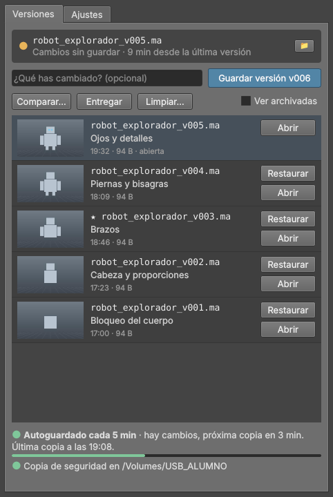
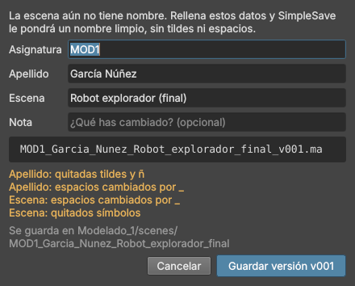
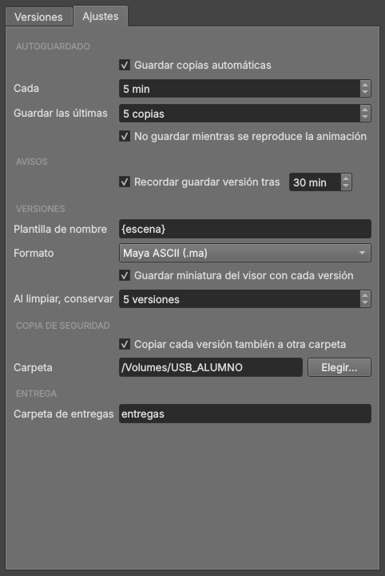

# SimpleSave

Guardado por versiones, autoguardado y recuperación para Autodesk Maya (2026 y 2027, Mac y Windows).



Un botón para guardar la escena como versión nueva (`robot_v004.ma`) con una nota de qué ha cambiado, un
autoguardado que se configura y avisa al volver, y nombres de archivo limpios para todos. Nunca sobrescribe una
versión: restaurar o recuperar siempre crea otra más.

*English summary: SimpleSave adds versioned saves (`scene_v001.ma`, `v002`…) with thumbnails and notes, a
configurable autosave that only runs when the scene changed, crash recovery prompts, clean file names, an optional
backup folder, delivery packaging (.zip with textures), version comparison and cleanup. Interface in Spanish, ready
for translation.*

## Instalar

1. Descarga o clona esta carpeta y déjala donde vaya a quedarse (por ejemplo `Documentos/maya/SIMPLESAVE`).
2. Abre Maya y arrastra `instalar.py` desde el Finder o el Explorador hasta el visor.
3. Aparece el menú **SimpleSave** en la barra de Maya. Se carga solo cada vez que abres Maya y el autoguardado
   queda encendido desde ese momento.

Maya 2027 puede preguntar si confías en el plug-in de una carpeta nueva: pulsa *Allow*.
Para desinstalar, borra `simplesave.mod` de la carpeta `modules` de tus preferencias de Maya (la ruta sale en el
Script Editor al instalar).

## Qué hace

| | |
|---|---|
| **Guardar versión** | `Ctrl+Alt+S` (`⌘+Alt+S` en Mac), el menú o el botón del panel. Guarda la siguiente versión libre con una nota opcional. Si ya existe un archivo con ese número, salta al siguiente. `Ctrl+S` sigue haciendo lo de siempre. |
| **Nombre guiado** | Si la escena no tiene nombre, pide las piezas de la plantilla (por defecto solo el nombre de la escena) y enseña cómo quedará. Quita tildes, ñ, espacios y símbolos. La guarda en `scenes/<nombre>/` del proyecto. |
| **Historial** | Lista de versiones con miniatura del visor, nota, hora y tamaño. Abrir, restaurar como versión nueva, editar la nota, marcar como importante, mostrar en la carpeta. |
| **Autoguardado** | Cada N minutos (5 por defecto) y solo si la escena ha cambiado. Va a una carpeta aparte, nunca encima de las versiones, y guarda las últimas N copias (5). Espera a que Maya esté libre y no guarda mientras se reproduce la animación. No cambia el nombre de la escena ni quita el aviso de cambios pendientes. |
| **Recuperar** | Al abrir una escena o al arrancar Maya, si hay un autoguardado más reciente que la última versión, ofrece recuperarlo como versión nueva. También busca la copia de emergencia que Maya deja en la carpeta temporal cuando se cuelga y las copias de escenas que nunca llegaron a tener nombre. |
| **Guardado comprobado** | Tras guardar comprueba que el archivo está completo. Si falla a medias, borra el archivo roto y la versión anterior queda intacta. |
| **Aviso** | Si pasan 30 minutos sin guardar versión, un mensaje discreto en el visor. |
| **Copia de seguridad** | Opcional: cada versión se copia también a otra carpeta (USB, Drive, OneDrive). Si no está conectada, avisa y sigue. |
| **Entrega** | Copia la última versión como `<nombre>_entrega.ma` y crea `<nombre>_entrega.zip` con forma de proyecto: escena, `workspace.mel` y texturas (incluidas las UDIM). Las texturas de fuera del proyecto van a `sourceimages/externas`. |
| **Comparar** | Dos versiones lado a lado: miniaturas, objetos añadidos y borrados y diferencia de caras. |
| **Limpiar** | Aparta las versiones antiguas a la carpeta `archivo`, dejando la primera, las 5 últimas y las importantes. No borra nada y se pueden devolver. |
| **Plantilla del profesor** | Un `simplesave.json` en la carpeta del proyecto fija la plantilla de nombre y los ajustes para toda la clase. |



## Plantilla del profesor

*SimpleSave › Crear simplesave.json del profesor* deja este archivo en la carpeta del proyecto. Lo que pongas manda
sobre los ajustes de los alumnos y aparece bloqueado en su panel; lo que no pongas lo elige cada uno.

```json
{
  "plantilla": "{asignatura}_{apellido}_{escena}",
  "valores": {"asignatura": "MOD1"},
  "autoguardado": true,
  "minutos": 5,
  "copias": 5,
  "aviso_minutos": 30,
  "formato": "ma",
  "carpeta_entregas": "entregas"
}
```

| Clave | Qué es |
|---|---|
| `plantilla` | Piezas entre llaves. `{escena}` siempre está. Valen otras como `{apellido}`, `{nombre}`, `{asignatura}`, `{ejercicio}`, `{curso}`, `{grupo}`. |
| `valores` | Piezas que rellena el profesor y el alumno no puede cambiar. |
| `autoguardado`, `minutos`, `copias` | Autoguardado encendido, cada cuántos minutos (1-120) y cuántas copias guardar (1-50). |
| `pausa_reproduccion` | No autoguardar mientras se reproduce la animación. |
| `aviso`, `aviso_minutos` | Recordatorio de guardar versión y cada cuánto. |
| `formato` | `"ma"` o `"mb"`. |
| `miniaturas` | Guardar miniatura del visor con cada versión. |
| `copia_activada`, `copia_carpeta` | Copia de seguridad a otra carpeta. |
| `carpeta_entregas`, `conservar_ultimas` | Carpeta de entregas dentro del proyecto y versiones que se quedan al limpiar. |

## Cómo se guarda

```
Modelado_1/                     proyecto de Maya
  simplesave.json               plantilla del profesor (opcional)
  entregas/                     robot_entrega.ma y robot_entrega.zip
  scenes/
    robot/
      robot_v001.ma
      robot_v002.ma
      archivo/                  versiones apartadas con «Limpiar»
      .simplesave/robot/
        historial.json          notas, horas, objetos y caras de cada versión
        miniaturas/v001.jpg
        autoguardado/robot_auto_20261124_194200.ma
    .simplesave/sin_titulo/autoguardado/   copias de escenas que aún no tienen nombre
```

Las escenas que ya tenían nombre (por ejemplo `scenes/casa.ma`) guardan sus versiones al lado: `casa_v001.ma`.
Los ajustes de cada alumno van en `simplesave/ajustes.json` dentro de la carpeta de preferencias de Maya.

## Atajo y estantería

Al instalar, SimpleSave asigna `Ctrl+Alt+S` (`⌘+Alt+S` en Mac) a «Guardar versión» si está libre. Como el juego de
atajos de Maya no se puede modificar, crea una copia llamada `SimpleSave_atajos`. Si lo prefieres en otra tecla,
busca «SimpleSave» en *Windows › Configuración › Editor de atajos*. *SimpleSave › Añadir botón a la estantería*
pone un botón en la estantería activa (clic: guardar versión; doble clic: abrir el panel).



## Para desarrollar

```
scripts/simplesave/
  nombres.py        limpieza de nombres, plantillas y números de versión (sin Qt ni Maya)
  historial.py      versiones, notas y carpetas ocultas (sin Qt ni Maya)
  autoguardado.py   cuándo autoguardar, rotación, qué recuperar (sin Qt ni Maya)
  gestor.py         guardar versión, restaurar, recuperar, entrega, limpiar (sin Qt ni Maya)
  config.py         ajustes del alumno y simplesave.json del profesor (sin Qt ni Maya)
  entrega.py, comparar.py, limpieza.py, archivos.py   (sin Qt ni Maya)
  panel.py, dialogos.py, iconos.py   interfaz (Qt)
  maya_servicios.py, interfaz_maya.py   todo lo que toca Maya
  i18n/es.json      textos de la interfaz
```

Pruebas sin Maya (con `pip install PySide6-Essentials` para las de Qt):

```
python -m unittest discover -s tests
```

Prueba con Maya sin interfaz (guardar versión, autoguardado con y sin nombre, restaurar, recuperar, .mb, entrega):

```
mayapy herramientas/prueba_maya.py
```

Los textos están en `scripts/simplesave/i18n/es.json`. Para otro idioma, copia el archivo (por ejemplo `en.json`),
tradúcelo y arranca Maya con la variable de entorno `SIMPLESAVE_IDIOMA=en`.

## Licencia

MIT. Ver [LICENSE](LICENSE).
